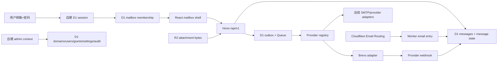

# Unimailbox：邮件系统实施计划

> Current interpretation (2026-10-10): this document preserves the October 4
> integration investigation and its subsequent decisions. Current delivery status
> is in [the ledger](capability-ledger.md#current-state), and staging evidence is
> in dated `docs/qa/` records. Schema is now 0033. The current UI reference is
> [satnaing/shadcn-admin](15-shadcn-admin-ui-redesign.md), replacing the original
> shadcn-admin-kit proposal below. Rich compose/R2, personal settings/localization
> and scheduled send are implemented with focused staging acceptance. SMTP and
> comprehensive provider/recovery acceptance remain separate work. Old local-only
> counts and "preview pending" statements below describe their dated snapshots.


**日期：** 2026-10-04\
**历史状态（2026-10-04）：** 三仓代码与 UI 基座审查完成；CAP-A1 自建身份和基础会话恢复、CAP-A2 UI 壳层、CAP-A3 按域名连接动态路由、Brevo webhook adapter 及通用早到事件重放有本地实现；入站 MIME 附件已写入 R2 并接通授权下载，CID 私有预览和旧孤儿对象回收已有本地实现；本地浏览器已验证登录、硬刷新恢复、首次改密、退出与管理/邮箱布局隔离；preview 边界、事件级幂等、SMTP、已关联对象生命周期和完整邮件闭环仍待完成\
**目标：** 在 Cloudflare Workers 上交付一个支持多用户、多域名、多邮箱授权的邮件系统；出站首选 Brevo，并通过 provider registry 为后续 SMTP/邮件服务商保留扩展位；入站使用 Cloudflare Email Routing；Web 界面和邮件核心遵循本项目的 contracts、授权与可靠投递约束。

**已确认的产品决策：**

- 所有后端、数据库和 provider 事件时间统一写入 UTC；API 输出 UTC 语义（新接口优先 RFC 3339 `Z`，历史 SQLite 无时区字符串在边界显式按 UTC 解释），前端按用户时区转换为 local time。历史数据修复需要独立迁移方案。
- 关闭公开注册，不做邀请制。账号、域名、邮箱和 membership 均由应用内 admin 管理；admin 可创建、停用、恢复和重置账号，首次登录强制修改初始密码。
- 完全移除 Cloudflare Access 作为认证或授权前置条件。Worker 不读取 `CF-Access-*` 头、不接受 Access JWT；管理员和普通用户都必须通过自建 D1 用户、密码和 session 模块，邮箱权限仍由 D1 membership 逐请求判断。
- V1 不把 Durable Object 当作邮箱主存储。D1 是用户、权限、消息、状态和审计的权威来源，目标是把持久附件迁移到 R2，Queue 处理异步发送；DO 只作为未来可选的邮箱级协调和实时连接层。
- 管理界面与邮箱界面使用同一个 Worker/React 工程，但采用独立路由、布局、API 前缀和权限上下文；以后有明确运营或扩展需求时再拆成独立部署。
- 原始 UI 提案（已被文档 15 取代）采用 [`marmelab/shadcn-admin-kit`](https://github.com/marmelab/shadcn-admin-kit) 作为视觉和布局基座，当前上游参考版本固定为 `78e32b93174937f0871877b3ddaf2ddd4d71ea16`。只引入经过审查的 shell、导航、表格、表单、对话框、反馈状态和 design tokens；不复制其认证、数据访问、示例业务或部署配置。管理端和邮箱端共用基础组件，但分别使用 `AdminLayout` 与 `MailboxLayout`，避免把管理操作混入普通邮箱工作流。

本文是当前代码事实和下一阶段执行顺序的工作基线。它不把 README、能力台账或测试数量单独当作交付证据，也不把两个参考项目整库复制到 Unimailbox。

## 1. 范围和术语

- **多用户：** 一个部署中的多个登录用户；每个用户通过 D1 授权访问一个或多个业务邮箱。
- **多域名：** 一个 Worker 处理多个 Cloudflare zone 的 Email Routing；邮箱地址由 `local_part + managed_domain` 构成；域名可独立选择出站 provider connection。
- **多租户：** 本期不做 SaaS 级租户隔离。先保证同一部署中的用户、邮箱、消息、附件和管理权限隔离；如果以后需要多个组织共享一套 Worker，必须新增 tenant_id、数据迁移和 ADR。
- **发信：** Brevo 是第一阶段唯一实际 provider，但业务模块只能依赖 provider-neutral contract。
- **收信：** Cloudflare Email Routing 的 Worker `email()` 入口；处理失败必须重新抛出，让平台重试。

## 2. 审查范围和证据边界

| 项目 | 本次检查 | 当前工作区状态 | 结论边界 |
| --- | --- | --- | --- |
| `Unimailbox` | Worker/Web 目录、D1 schema/migrations、入口、路由、provider、附件、认证、计划和台账；运行 typecheck/lint/test/build | `cf5acfdcdcaff2b6b752acf6b8536fa9d93473b6`，分支 `cap/CAP-065-mailbox-sharing-ui`；有大量未提交改动，无本次新提交 | 本地实现证据；不代表远端部署或真实邮件 |
| `agentic-inbox` | 当前账号流程、D1 grants、HTTP 组装、Email Routing、MailboxDO、R2、provider registry、React Router/Query UI | `6fb4c528d98d014068434da9edd08f6b81f2905e`；`main` 有大量未提交改动 | 当前工作区不能替代独立预览验收；参考模式需按 Unimailbox 规则改造 |

### 2.1 Unimailbox 本次可重复的本地证据

- 本次分层重跑完成非 Worker 86 个文件、1188 个测试，Worker 51 个文件、854 个测试，以及 test-kit Worker 1 个文件、17 个测试。Web 项目包含在非 Worker 项目内，单独运行时为 57 个文件、435 个测试。Worker 测试需要本地 loopback 权限；这里的通过只证明本地绑定。
- `pnpm typecheck`、`pnpm lint`、`pnpm format:check`、`pnpm build` 和最后的 `pnpm build:web`：本轮通过；`pnpm scaffold doctor`（14/14）是前一轮结果。最后的 Web 构建为 CSS 29.05 kB、主 JS 674.50 kB（minified），仍有 500 kB chunk 警告。
- Worker build 的 Wrangler dry-run 能生成资产并列出 D1/KV/R2/Queue/Assets bindings；Wrangler 写诊断日志时出现 EPERM 警告。该命令没有创建或验证远端资源。
- 本地 Vite → Worker 浏览器会话已验证管理员登录、硬刷新后 cookie-backed refresh、新 Bearer `/me`、退出后无法 refresh、`/mailbox` 与 `/admin` 布局切换、admin 创建账号；新建普通用户首次登录进入强制改密页，改密后进入邮箱，直接打开 `/admin` 和 `/admin/users` 被引回邮箱，而管理员仍能进入管理页。390px 暗色管理页无全局横向溢出，用户表格可键盘横向滚动。独立浏览器会话的页面错误列表为空。Email Routing、Queue、Cron、Brevo webhook、真实入站邮件或完整收件箱流程尚未验证；本地浏览器结果也不代表 preview。
- 当前 `apps/worker/wrangler*.jsonc` 未声明 Durable Object namespace/class；`apps/worker/src/platform/env.ts` 也没有 DO binding，故 DO 仅是架构评估，不是当前已实现能力。

## 3. Unimailbox 当前代码审查

### 3.1 已经具备、应当保留的基础

1. **Cloudflare 入口形状正确。** `apps/worker/src/worker.ts` 统一导出 `fetch`、`email`、`queue`、`scheduled`；HTTP、入站、队列和定时任务分别位于 `apps/worker/src/entrypoints/`。
2. **模块边界比旧系统清晰。** `identity`、`tenancy`、`messages`、`inbound-mail`、`outbound-mail`、`attachments`、`admin`、`provider-sync` 和 `platform` 已有单向依赖、D1 repository/use case 和 contracts。
3. **出站可靠性基础完整。** Compose 将消息、收件人、`mailbox_messages`、`outbound_jobs`、审计和 idempotency 记录放进一个 D1 batch；队列支持 claim/lease、重试分类和 `queued -> sending -> sent/failed`。
4. **安全数据基线较好。** provider credential 有 AES-GCM 包装；敏感字段不进入普通日志；消息 HTML 有 sanitizer；附件上传具备大小、所有权、过期、一次性消费和越权下载测试。
5. **Web 已有业务表面。** `apps/web/src/features/mailbox/` 已覆盖邮箱列表、文件夹、线程、详情、compose、草稿恢复、附件、stars 和共享成员；`features/admin/` 已有域名、角色、签名、设置、连接、审计和 webhook 页面。
6. **部署脚本和迁移意识较强。** `scripts/deploy.ts`、D1 migration tracking、doctor、preview gate 和 `wrangler` binding 检查为后续预览发布提供了基础。

### 3.2 审查发现、当前进度和剩余风险

| 优先级 | 代码事实 | 影响 | 计划处理 |
| --- | --- | --- | --- |
| P0 | 根 README 和历史 CAP 表仍有旧的“CAP-042 下一步”、Better Auth/邀请制描述；本计划与台账 overlay 已记录当前方向 | 后续任务容易从历史状态开始 | 阶段 0 在不覆盖历史记录的前提下，把入口文档指向当前计划并逐项清理运行配置说明 |
| P0 | **会话绕过已在本地修复**：`authn.ts` 现在拒绝缺少 D1 session id 的 KV Bearer payload，并检查 session 归属、过期、撤销和用户状态；生产/dev Wrangler、preflight 和 deploy 流程已移除 Better Auth 运行配置与 Secret，迁移兼容源文件和 test-only fixture 仍保留 | 迁移 adapter 仍需隔离并在真实 preview 验证自建身份闭环 | 阶段 1 完成浏览器及 preview 回归；迁移完成后再删除兼容 adapter 与 test-only fixture |
| P0 | **管理员邮箱内容绕过已在本地修复**：旧 `assertCan(..., isAdmin)` 允许 `role.manage` 用户绕过 membership 读取他人草稿、邮件和附件或从其邮箱发信；现已移除该分支，并让邮箱目录列出 owner 或明确授权的 member | 管理端权限与邮箱内容权限重新独立；管理员可以管理授权，但访问内容仍需 owner/member 身份 | 阶段 1 继续核对所有 admin API、权限变化后的缓存失效，以及浏览器和 preview 的跨账号矩阵 |
| P1 | ~~`apps/worker/src/entrypoints/queue.ts` 固定 `providerRegistry.get('brevo')`，而 Compose 选择“第一个 active provider connection”~~ **已修复 2026-10-04**：Compose、draft send 按 mailbox 所属 domain 的 `outbound_connection_id` 选择，Queue 按 job connection 的 `provider_key` 查 registry | 多域名或第二个 provider 会写入一种连接、发送时却使用另一种 adapter | 阶段 3 继续补齐 SMTP adapter、provider webhook/status reconcile 和 preview 证据 |
| P1 | Brevo 发送已有 provider-neutral payload 和 JSON body `Idempotency-Key`；webhook 验签、解析、事件映射及 UTC 规范化由 registry adapter 负责；迁移 0027 为早到事件保存通用消息 ID/状态投影并回填旧 Brevo 记录 | 新 provider 的事件可经同一重放路径，但尚缺真实 provider 样本、事件级幂等和第二个实际发送 adapter 的运行证据 | 阶段 3 用 Worker 和 preview 验证新旧事件重放；确认真实 Brevo 事件键后实现去重，再接入 SMTP adapter |
| P1 | ~~`apps/worker/src/platform/cache.ts` 的附件字节目前写入短期 `CACHE`/KV；`ATTACHMENTS` R2 binding 还没有成为已消费邮件的持久字节来源~~ **已修复 2026-10-04**：出站上传继续写 staging KV，compose consume 前复制到 R2；入站附件直接写 R2 和独立 D1 元数据；下载/Queue 优先 R2 并兼容 KV 回退。旧入站孤儿对象定时回收和 Bearer 授权的 CID 预览已本地实现 | Worker 重启和 TTL 到期后的已关联附件可从 R2 读取；已关联对象的删除与真实环境仍需验证 | 阶段 5 补齐消息删除策略和 preview 真实附件证据 |
| P1 | 入站现已按 Cloudflare `message.to` 信封地址只投递到该回调的 active mailbox，并用 `message.from` 执行 sender policy；但尚未持久保存 envelope sender、`Authentication-Results`、Return-Path 等来源证据 | 仅展示 MIME `From` 会让域名伪造和钓鱼难以判定，也无法事后核查策略依据 | 阶段 2/4 保存 envelope/headers/auth result，显示层区分“声明的 From”和认证状态；不把 MIME From 当作已验证身份 |
| P1 | 历史 CAP 行记录了旧的 DO/R2 JSON grants 与旧认证路线；当前计划和台账 overlay 已收敛新的多用户、多域名执行顺序 | 若只看旧 CAP 行，仍可能误用参考实现 | 后续 CAP 以本文和 `11-agentic-inbox-adaptation.md` 为边界，逐项维护 contract、review 和证据 |
| P2 | setup、admin 和 mailbox 页面已有较多实现，但没有一条新部署上的 admin 创建账号、登录、切换邮箱、发信、收信、附件、webhook 浏览器闭环证据 | 本地绿灯不能说明可发布 | 阶段 7 用真实 preview + 浏览器 + 真实邮件头完成验收 |

### 3.3 当前不应重复做的事情

- 不把现有 `apps/web` 删除后照搬另一个项目；应保留已有 TanStack Router/Query、contracts、错误状态、草稿缓存和管理页面。
- 不把认证、授权或 mailbox metadata 放进 R2/KV 作为事实来源；D1 才是用户、域名、邮箱、membership、消息和审计的权威存储。
- 不把消息在 provider 实际受理前标为最终 `sent`；UI 需要显示 `queued`、`sending`、`accepted/delivered/bounced/failed` 的不同含义。
- 不把 provider 的历史时间修复当作本项目需求；所有持久化时间只按 UTC 规则写入，前端负责本地化显示。
- 不把 Durable Object 作为 V1 邮箱正文、附件、权限或投递状态的事实来源；在没有实测并发或实时连接需求前不增加邮箱 DO 绑定。
- 不以“测试文件数量”替代真实预览环境证据；每个阶段都要记录静态、Worker、浏览器、provider 和远端证据的层次。

### 3.4 CAP-A1 本地实现进度

- 已新增 `0026_admin_user_lifecycle`：`users.must_change_password` 和 UTC 初始密码过期时间；`CURRENT_SCHEMA_VERSION` 已更新为 `0026`。
- `authn` 现在只接受带有效 D1 session id 的 Bearer token；逐请求检查 session 归属、过期、撤销和用户 active 状态。缺少 session id 的旧 KV token 返回 401；Cloudflare Access 头和 Better Auth cookie 不参与认证。前一轮完整 Worker 项目 854/854 通过。登录响应设置 HttpOnly refresh cookie。浏览器验收发现并修复了无 cookie 时 400 被误当路由错误、以及 refresh 成功后新 Bearer 未在二次 `/me` 前写入内存的问题；修复后独立会话在硬刷新时依次观察到 `/me` 401、`/refresh` 200、带新 Bearer 的 `/me` 200。
- 公开 `/api/v1/auth/register` 已稳定返回 `REGISTRATION_DISABLED`；账号创建、初始密码、重置、停用/恢复接口位于 `/api/v1/admin/users*`，初始密码只在创建/重置响应中出现一次。
- 已增加首次改密 `/api/v1/auth/change-password`，未完成改密的 session 由 `requirePermission` 拒绝业务请求；管理员重置和停用会撤销旧 session。
- `/auth/login` 和 `/auth/me` 返回从 D1 权限关系实时计算的 `canAccessAdmin` 界面提示；普通用户默认 role 中的 message/mailbox 权限不构成管理界面资格。所有 `/admin/*` 路由进入前重新读取 `/me` 并隐藏管理壳层；管理 API 仍各自逐请求执行 `requirePermission`。本地浏览器已验证普通用户直达管理深链被引回邮箱。
- Worker 生命周期测试已覆盖 admin 创建、公开注册拒绝、首次改密和停用后的旧 session 拒绝；`/admin/users` 已提供创建账号、一次性初始密码展示、重置密码、停用和恢复操作，并在前端按用户 session 隔离 Query key。
- 旧邀请注册、Better Auth 登录路径的 Worker/Web 测试已迁移为“公开注册关闭 + 自建 `/auth/login`、`/auth/me`、`/auth/logout`”契约；测试通过只证明本地 Worker/Web 行为，仍不代表远端部署或真实邮件闭环。创建、重置和状态变更现在把业务写入、D1 幂等记录和 `user.*` 审计事件放在同一 batch 中，并处理同一幂等键的并发竞态。
- 生产和本地开发 Wrangler 配置、preflight 和 deploy secret 流程已移除 Better Auth 运行变量/Secret；旧 Better Auth adapter 仅保留在迁移兼容代码和 test-only fixture 中，不再是 Worker 入口或预检要求。Cloudflare Access 头、cookie 和 JWT 均不参与认证。

### 3.5 历史 UI 提案（shadcn-admin-kit；已由文档 15 取代）

`shadcn-admin-kit` 作为 Unimailbox 的前端基础界面，采用“组件和布局迁移、业务边界保留”的方式：

1. **引入范围。** 在固定上游 commit 后，先导入其应用 shell、侧边栏/顶部栏、响应式导航、表格、分页、表单、Dialog/AlertDialog、Toast、空状态、加载骨架、错误状态、主题变量和图标约定。导入后统一放入 `apps/web/src/components/ui/` 与 `apps/web/src/components/layouts/`，并保留本项目的无障碍属性、测试 ID 和错误契约。
2. **管理端。** `/admin/*` 使用独立 `AdminLayout`：用户生命周期、域名、邮箱、membership、provider connection、签名、webhook、审计和设置均从管理导航进入；每个页面仍由 Worker `requirePermission` 决定是否可读写，UI 只负责呈现 loading/403/错误/成功状态。
3. **邮箱端。** `/mailbox/*` 使用独立 `MailboxLayout`：邮箱选择器、文件夹、全局收件箱、线程列表、详情、compose 和附件工作区采用 kit 的 shell 和密度；所有 TanStack Query key、mailbox grant、草稿隔离、HTML sanitizer 和时间格式化继续使用 Unimailbox 逻辑。
4. **视觉系统。** 将 kit 的 CSS variables 映射到现有 `apps/web/src/styles/tokens.css`，先保持现有语义 token 名称，再逐步替换自建 `Button/Card/Input` 的视觉实现。暗色模式、键盘导航、焦点环、`prefers-reduced-motion` 和移动宽度必须在导入时一起验收。
5. **依赖与许可证。** 导入前记录上游 commit、许可证、依赖版本和实际复制文件；优先复制源码组件并保留版权声明，不直接把上游 app、router、auth、API client、mock data 或构建配置覆盖到 Unimailbox。若上游使用 Tailwind/CVA/Radix/Lucide 等依赖，逐项评估 bundle、SSR/Worker 资产和现有 Vite 配置后再添加。
6. **迁移顺序。** 先建立 `UiFoundation`（tokens + primitives + shell）和 screenshot/interaction 基准，再迁移 `/admin`，最后迁移 `/mailbox`；每一步保留现有路由和 API 契约，保证可以回滚到当前页面实现。不得在 UI 迁移期间重新引入 Cloudflare Access、邀请注册或前端持久化 access token。

**UI 基座退出证据：** 固定 commit 的来源和许可证记录；管理员与普通用户分别进入 `/admin/*`、`/mailbox/*` 的路由/权限测试；桌面、窄屏、暗色和键盘操作的浏览器验收；无跨用户 Query cache、无明文 token 持久化、无业务 API 越权；主 chunk 和 CSS 体积与当前基线对比。

## 4. 邮件核心约束

邮件行为以 Unimailbox 的数据模型、contracts 和授权规则为准：

- 入站使用 SMTP envelope recipient 确定目标邮箱；MIME From 是声明身份。持久化失败必须向运行时传播。
- 邮件、收件人、邮箱关联和审计通过 D1 原子写入；原始 MIME 和附件字节保存在 R2。
- 出站使用持久 outbox 和 Queue；provider SDK 只存在于 adapter 边界，发送和 webhook 状态分开记录。
- 登录账号与业务邮箱分离；读写邮件必须同时满足全局权限和邮箱授权。
- 邮件 HTML 统一清理；私有附件需要授权，收件人文件链接使用受控 capability。
- 前端使用共享 contracts、query keys 和统一 React 界面，不引入独立认证或存储事实来源。

后续章节保留实施方向和阶段计划；是否已经交付以 capability ledger 的 Current state 为准。

## 5. `agentic-inbox` 审查结论

### 5.1 应吸收的长处

1. **单 Worker 组装方式：** `workers/app.ts`/`workers/http.ts` 先挂 API、再挂 React Router 页面 fallback，并同时导出 Email Routing 入口；这比手工拼接固定资产文件可靠。Unimailbox 只复用组装方式，不复用其账号开户或 DO 主存储决策。
2. **自建账户和会话：** 应用自建 identity module 以 D1 用户/会话为唯一事实来源；现有 Better Auth 代码只作为迁移和兼容审查对象，不作为外部身份权威。关闭公开注册，管理员直接创建、停用、恢复和重置账号，账号首次登录必须修改一次性初始密码，停用账号时每次请求重新检查状态。
3. **授权模型：** 登录身份和业务邮箱分离；一个用户可拥有多个 mailbox membership；管理员管理授权，普通会话不因 email 或旧 role 自动获得后台权限。
4. **provider registry：** provider-neutral `SendProviderMessage`、adapter 错误分类、Brevo webhook、provider config 和审计，为后续 provider 扩展提供稳定边界。
5. **邮件 UI：** nested mailbox routes、持久侧栏、global inbox、responsive split view、TanStack Query key/mutation invalidation、线程、文件夹、草稿、附件和 delivery status 组件。
6. **入站可靠性：** Email handler 在持久化失败时重抛，不提前确认；API、用户会话、自建管理员和 webhook 使用独立路由边界。

### 5.2 必须拒绝或改造的模式

| Agentic Inbox 模式 | Unimailbox 决定 |
| --- | --- |
| 每个邮箱一个 Durable Object + SQLite | 拒绝当前拓扑；Unimailbox 继续 D1 + 明确 module ownership + durable outbox。除非未来有容量证据，否则不为每邮箱切换存储模型。 |
| mailbox metadata/settings/grants 放 R2 JSON | 拒绝；D1 保存身份、域名、邮箱、membership、provider connection、设置和审计，R2 只保存二进制附件。 |
| 边缘准入身份替代应用授权 | 拒绝；管理员和普通用户都由自建用户模块认证，普通用户仍受 D1 mailbox grant 逐请求约束。 |
| provider 发送前就把消息标成 `sent` | 拒绝；沿用 Unimailbox outbox 状态机和 provider idempotency。 |
| AI/MCP/自动草稿作为核心入口 | 延后；核心收发、授权、审计和预览闭环通过后再单独定义 opt-in 能力。 |
| 当前工作区 README/本地测试作为发布证明 | 拒绝；Agentic Inbox 的身份重构工作区同样有大量未提交改动，真实远端 D1/R2/KV 和真实邮件仍需单独验收。 |

## 6. 推荐目标架构



### 6.1 数据和绑定原则

- `managed_domains`：标准化、大小写不敏感、唯一；状态和默认出站 connection。
- `mailboxes`：`domain_id + local_part` 唯一；邮箱状态、显示名、owner；删除使用显式软删除和审计。
- `mailbox_members`：`mailbox_id + user_id` 唯一；角色或 capability 只能从封闭集合产生；owner 不因客户端字段而改变。
- `messages` / `message_recipients` / `mailbox_messages`：邮件本体和一个邮件到多个授权邮箱的投影分离；列表查询必须带 mailbox scope。
- `message_user_state`：已读、star、删除等用户级状态与共享邮件本体分开。
- `provider_connections` / `encrypted_credentials` / `outbound_jobs` / `webhook_deliveries` / `provider_message_state`：provider 连接和投递历史独立于消息 UI。
- `attachment_uploads` / `message_attachments`：D1 保存 owner、mailbox、大小、内容类型、过期和消费状态；未消费内容短期 staging，已关联邮件内容持久化到 R2。
- `audit_events`：管理、收信、发信、附件消费、provider 状态变化使用 request/correlation id，严禁保存明文 API key、密码、cookie 或原始密钥。
- 所有持久化时间都表示 UTC 瞬间。D1 文本时间由统一的 UTC formatter 生成，旧身份表中的 epoch milliseconds 也按 UTC 瞬间解释；新增 API 时间字段返回带 `Z` 的 RFC 3339，历史无时区 SQLite 值在 API 或前端边界按 UTC 解释；数据库不保存用户 local time。
- `received_at`、`created_at`、`updated_at`、`sent_at` 和 provider `event_at` 各自表示其实际事件，不用 provider 历史接口回填另一个事件；无法取得 provider 时间时保留空值或记录为未知，不能用当前时间伪造。
- 具体约定：SQLite text 时间统一写 `YYYY-MM-DD HH:mm:ss` 的 UTC 值（字段名和 schema 注释标明 UTC），需要毫秒的内部字段写 Unix milliseconds；新增 API 序列化为 `YYYY-MM-DDTHH:mm:ss.sssZ`，历史裸 SQLite 值在边界补 `Z` 后再展示；前端使用用户/浏览器时区格式化展示，原始 UTC 值用于排序、cursor、审计和重放。

### 6.2 认证和入口原则

- 普通用户：自建 identity module 提供 email/password + D1 session；现有 Better Auth 表或适配代码仅作为迁移输入，不能成为最终登录入口。关闭公开注册，由 admin 创建账号。创建时只返回一次随机初始密码，数据库只存密码哈希并标记 `must_change_password`；首次登录必须改密。
- 管理员：同一自建用户模块的 admin role/capability 是唯一管理身份来源；admin API 每次请求都检查 session、账号状态和 D1 权限，普通密码账号不会因为 email、邮箱 membership 或客户端字段自动升级。
- webhook：按 provider connection 的签名 secret 独立认证；不能要求用户 Cookie，也不能被通用用户 middleware 吞掉。
- Email Routing：只依赖 Cloudflare 事件对象；不读取浏览器身份；找不到邮箱或策略拒绝时明确 `setReject`，数据库/附件失败时重抛。
- 所有 mailbox-scoped API：先认证，再按 path mailbox id 检查 grant，再读取消息/附件；不存在、无权和附件缺失可按安全错误合并，不能泄漏跨邮箱存在性。

### 6.3 管理界面与邮箱界面分区

推荐保持一个 Worker、一个 React 工程和一套部署资产，但在路由、布局、查询缓存和 API 授权上完全分开：

| 表面 | 路由与布局 | API 前缀 | 权限上下文 | 主要功能 |
| --- | --- | --- | --- | --- |
| 管理端 | `/admin/*` + `AdminLayout` | `/api/v1/admin/*` | `requireAdmin`：自建 session + admin capability | 用户/账号生命周期、域名、邮箱、membership、provider connection、webhook、审计、系统设置 |
| 邮箱端 | `/mailbox/*`（可保留 `/mail/*` 别名）+ `MailboxLayout` | `/api/v1/mailboxes/*` | `requireUser` + mailbox capability | 收件箱、文件夹、搜索、线程、草稿、写信、回复/转发、附件 |
| 公共端 | `/login`、`/password/change`、`/setup` | `/api/v1/auth/*`、`/api/v1/setup/*` | 匿名或一次性初始密码状态 | 登录、首次改密、安装初始化；不提供公开注册 |

两个 layout 共享设计 tokens、错误组件和基础 API client，但 admin 查询 key 与 mailbox 查询 key 分开。切换用户、停用账号或权限变化时，清理对应 Query cache；admin API 逐请求检查管理权限，mailbox API 逐请求检查邮箱授权，即使同一用户兼任管理员也不自动获得所有邮箱的读取权。这样先保持单 Worker 的运维简单性，同时为以后独立部署留下清晰边界。

### 6.4 Durable Object 邮箱存储评估与边界

#### 当前证据

- Unimailbox 当前没有 `durable_objects` binding 或 DO migration；Worker 的事实拓扑是 D1、R2、KV、Queue。入站邮件、mailbox projection、审计在一个 D1 batch 中写入，出站使用 D1 durable outbox + Queue。
- 当前 compose 消费前会将附件字节从短期 KV staging 复制到 R2；下载和 Queue 优先读取 R2，并保留 KV 回退。入站 raw MIME 与解码附件持久化到 R2，元数据由 D1 保存。旧孤儿对象定时回收和使用 Bearer 请求的 CID 私有预览已有本地测试；已关联对象的删除策略及真实 preview 回归仍需完成。
- Agentic Inbox 的 `MailboxDO` 是“每个 mailbox 一个 DO + SQLite”方案：正文、文件夹、线程、草稿、provider 状态和附件 metadata 在 DO SQLite，附件 bytes 在 R2；全局收件箱需要先查 mailbox grants，再 fan-out 到多个 DO 合并结果。

#### 方案比较

| 方案 | 具体用途 | 优点 | 代价与风险 | 结论 |
| --- | --- | --- | --- | --- |
| D1 + R2 + Queue（目标 V1） | D1 保存 users/domains/mailboxes/members/messages/status/audit/outbox；R2 保存 raw MIME、正文大对象和附件 bytes；Queue 负责发送与重试 | 关系查询、跨邮箱汇总、权限和 provider 状态可以在同一权威模型中完成；D1 batch 可表达入站 fan-out 和 outbox 幂等 | 单邮箱高并发需要 lease/idempotency；大正文和附件必须控制 D1 行大小并转 R2 | **V1 采用** |
| 每邮箱 `MailboxDO` 主存储 | 以 `idFromName(mailboxId)` 路由邮件 CRUD、线程、搜索和草稿；DO SQLite 存邮件和附件 metadata | 邮箱内操作天然串行；局部 SQLite 查询和事务简单；故障可按邮箱隔离 | 全局 inbox/跨邮箱搜索要 N 个 DO fan-out；D1 grants、目录和 provider 状态与 DO 双写；DO/R2/D1 无跨服务事务；备份、迁移、删除和大邮箱容量需单独运维 | **V1 不采用** |
| `MailboxCoordinatorDO` 协调层 | 每邮箱只保存短租约/锁、WebSocket subscriber/presence、事件序号或 cache invalidation cursor | 可提供邮箱级串行协调和实时通知，不改变 D1 查询模型 | 增加 binding、migration、stub 失败和一致性边界；若把业务事实写入 DO，会再次形成双写 | **按需预留** |

#### V1 具体边界

1. 不新增邮箱主存储 DO、DO SQLite migration 或 `MailboxDO` binding。D1 是唯一邮件事实来源；R2 是附件和 raw MIME 的字节来源；KV 只做短 TTL staging/cache；Queue 是 outbox 的异步执行层。
2. 预留 `MailboxCoordinator` 接口，默认实现为 no-op/D1 lease。只有在需要实时 inbox push、WebSocket/presence、邮箱级强串行协调，或实测 D1 lease 成为瓶颈时才引入 `MailboxCoordinatorDO`。
3. 若采用 DO，按 `idFromName(mailboxId)` 定位实例；DO 只保存 `mailbox_id`、短期 lease/lock、subscriber/presence 和 invalidation cursor。用短 schema 初始化和 `transactionSync` 保证协调记录原子更新，不使用全局单 DO，也不在请求间依赖内存状态。
4. DO 不保存邮件正文、附件 bytes、provider credential、用户/邮箱权限、最终 delivery status 或审计事实。业务请求必须先完成 D1 认证/授权；最终消息和状态仍由 D1 transaction + idempotency 确认，DO/R2 通知失败不能回滚已提交的 D1 事实。
5. 采用前必须提供 load/latency 证据、跨邮箱 fan-out 基线、重启/重试测试、DO migration/备份/恢复 runbook，以及 D1 与 DO 的故障降级策略；没有这些证据就继续使用 no-op/D1 实现。

### 6.5 Provider plugin contract

每个 provider plugin 至少可提供：

```ts
interface ProviderPlugin {
  outbound: OutboundProviderAdapter
  webhook?: WebhookProviderAdapter
  sync?: SyncProviderAdapter
  connectionSchema: ZodType<unknown>
}
```

`SendProviderMessage`、`ProviderSendResult`、`ProviderEvent` 和 `SafeProviderError` 放在 contracts；业务模块不得 import Brevo/Resend/SMTP SDK。发送 adapter 负责 payload、`Idempotency-Key`、超时、重试分类和 provider message id；webhook adapter 必须先验签 raw body 再 JSON parse；可选 sync/reconcile adapter 只负责 provider message id、delivery 状态、事件重放和早到 webhook reconcile，不负责历史时间修复或用 provider 日期覆盖 canonical message time。

## 7. 分阶段实施计划

每个阶段都要先建立 capability contract，再实现、独立 review、跑质量门槛，并把结果写入台账。阶段之间可以共享当前未提交工作区，但不能用一阶段的“代码存在”代替下一阶段的验收。

### 阶段 0：状态冻结、边界确认和工作区清理

**目标：** 让文档、分支、代码和运行配置描述同一个系统。

1. 保存三个仓库的 `git status`、当前 commit、未提交 diff stat；不重置、不清理用户改动。
2. 将当前 CAP-069、setup、admin、mailbox、provider 和附件实现逐项映射到 `capability-ledger.md`，标出 Implemented、Local-only、Preview-pending、Deferred。
3. 更新 README/台账中的下一能力，明确当前真正阻塞项是自建身份切换、provider 路由、R2 持久附件和 preview closed loop。
4. 产出 [`14-durable-object-mailbox-adr.md`](./14-durable-object-mailbox-adr.md)：记录当前无 DO binding、D1/R2/Queue 的事实拓扑、MailboxDO 主存储比较、`MailboxCoordinator` 预留接口和采用门槛；没有负载或实时需求证据时不得添加邮箱 DO。
5. 建立 `work/active/` 之外的本计划对应任务说明，声明每个后续 CAP 的文件所有权和 review 角色。

**退出证据：** ledger 与 `git diff` 一致；无“代码已写=线上已交付”的描述；三仓库的参考 commit 和许可证记录齐全。

### 阶段 1：身份、管理员和邮箱授权切换

**目标：** 完成多用户的可信身份边界。

1. 以自建用户模块的 D1 `users`、`sessions`、`user_roles` 和 KV 短期 token 索引为唯一会话来源；每个 Bearer token 必须绑定有效 D1 session id。盘点现有 Better Auth 表，仅在迁移阶段读取并建立可回滚映射，不把其 endpoint 或 Cloudflare Access assertion 作为最终登录入口。
2. 管理员直接创建账号：后端生成一次性随机初始密码，只存密码哈希和 `must_change_password`/过期状态，响应只显示一次；首次登录强制改密，管理员不能读取后续密码。Admin reset 使用同一机制，立即撤销旧 session 并使账号在改密前只能访问密码变更页面。
3. 关闭普通公开注册；页面、API、缓存和旧客户端同时拒绝自助注册，停用现有 `registration_keys`/注册路由，不新增 invitation token/table/accept flow。
4. 提供 admin 的 reset、deactivate、reactivate 和 revoke sessions 操作；每次受保护请求复核用户 active/deleted 状态，改密或停用立即使旧会话失效，并清理前端 Query cache。
5. 为 `/admin` 和 `/api/v1/admin/*` 建立应用内 `requireAdmin` context；检查自建 session、admin role/capability 和账号状态，普通用户 session 不能升级成管理员。
6. 将 mailbox grant 统一迁入 D1；所有列表、详情、搜索、线程、附件、发送、回复和转发都以 path mailbox id 做二次授权。
7. 建立 UTC timestamp contract：盘点所有 D1 text/integer 时间列和 SQL defaults，统一由 UTC clock/formatter 写入；旧身份表的 epoch-ms 只按 UTC 瞬间迁移，新增 API 一律输出带 `Z` 的 RFC 3339，历史 SQLite 无时区值在 API/`LocalDateTime` 边界显式按 UTC 解释，前端只在展示层转换 local time。

**重点文件：** `apps/worker/src/modules/identity/`、`apps/worker/src/modules/admin/`、`apps/worker/src/http/middleware/authn.ts`、`authz.ts`、`http/router.ts`、`database/migrations/`、`apps/web/src/features/auth/`、`apps/web/src/features/admin/`、`app router` 的登录/首次改密页面；现有 `apps/worker/src/integrations/better-auth/` 仅作为迁移兼容适配层审查。

**退出证据：** 匿名、普通用户、未授权用户、普通 admin、伪造/缺失 admin capability、过期 session、停用用户的 HTTP 交叉矩阵；真实本地 D1 migration；浏览器 admin 创建账号→一次性初始密码登录→首次改密→退出/重置/停用/恢复；UTC 写入、`Z` API 输出和前端 local time 渲染测试。

**本地进度（2026-10-04）：** 管理员全局 `role.manage` 不再绕过 mailbox `assertCan`；邮件列表、草稿、发送和附件下载的 Worker 测试覆盖“无 membership 拒绝、授予 membership 后允许”。`GET /api/v1/mailboxes` 现包含共享给用户的邮箱，且不会因为全局管理员角色列出未授权邮箱。管理员不能停用或删除自己的当前账号。浏览器与远端 preview 的跨账号闭环仍待验证。

### 阶段 2：多域名和入站邮件闭环

**目标：** 任意已配置 zone 的 catch-all 都能将邮件投递到正确 mailbox，并保留可审计的来源信息。

1. 收敛 `managed_domains`、`mailboxes`、domain allow-list 和 Email Routing 配置检查；创建 mailbox 时禁止未知域名和重复地址。
2. 每次 Email Routing 回调只按该回调的 `message.to` 信封地址匹配一个 active domain/mailbox；多个信封收件人由各自的回调分别投递，不因 MIME `To/Cc` 列出其他本地域名邮箱而额外 fan-out。`To/Cc` 仅作原始邮件元数据；Bcc 信封收件人即使不在头中也应收到邮件。
3. 保存 MIME `From`、envelope sender、Return-Path、Received、Authentication-Results、DKIM/SPF/DMARC 结果（若平台提供）；UI 明确显示声明身份和认证状态。
4. 实现 blocklist、subject/content/from 过滤和 per-role/domain policy，但过滤在 D1 写入前执行；sender policy 以 Cloudflare 提供的 envelope sender 为输入，RFC `From` 作为声明身份另存；拒收不生成半成品消息。
5. 消息、recipients、mailbox projections、初始 user state 和 receive audit 在一个 D1 batch 中写入；成功后才确认事件，异常重抛。
6. 将 `received_at` 和所有入站审计时间以 UTC 写入；邮件 `Date` header 只作为原始 header/声明信息保存，不能覆盖 canonical receive time，也不触发历史时间修复。
7. 为 `thread_id`、`in_reply_to`、`references`、CC/BCC、raw headers 建立稳定 contracts 和索引。

**重点文件：** `apps/worker/src/entrypoints/inbound-email.ts`、`modules/inbound-mail/`、`modules/messages/`、`modules/tenancy/`、`database/schema/messages.ts`、`apps/web/src/features/mailbox/`。

**退出证据：** 多域名、多收件人、未知收件人、拒收策略、恶意 header、重复 Message-ID、D1 写失败重试和消息归属隔离的 Worker 测试；preview Email Routing 真实投递一封每域名邮件。

### 阶段 3：Brevo 出站和 provider registry

**目标：** 让 Brevo 真正可用，同时不把业务锁死在 Brevo。

**当前进度（2026-10-04）：** 已完成按 domain connection 的 compose/draft 选择、按 job
`provider_key` 的 Queue registry dispatch；连接和 adapter 在 job claim 后检查，停用或未注册
provider 会在 D1 留下 terminal 结果，终态重复投递直接确认。Brevo 仍是当前唯一已注册 adapter。
管理员域名绑定出站连接已通过 `PATCH /api/v1/admin/domains/:id/outbound-connection` 接通；
当前 webhook receiver 已补齐 provider-key/active-connection 绑定、raw bytes 大小限制与验签、
按 connection 隔离的早到事件 reconcile、UTC 事件重放和 malformed payload 处理。Brevo
webhook 验签、事件映射和时间规范化已抽到 registry 中的 `WebhookProviderAdapter`，业务处理器
消费 `ProviderWebhookEvent`。迁移 0027 新增 adapter 验证后的 provider 消息 ID 和消息状态字段，
回填旧 Brevo 记录；早到事件 reconcile 已改为读取这些通用投影，不再解析 Brevo 事件名称。
该路径已通过本地 SQLite 迁移检查和静态构建；新增的 Worker 重放测试因本地测试审批额度限制
尚未执行。事件级幂等、SMTP adapter 和 preview 真实 provider 证据仍未完成。
实施事件去重前，必须从真实 Brevo 样本确认事件 ID 的唯一性、缺失 ID 时的策略和并发重放行为。

1. 已将 `provider_connections` 与 `managed_domains.outbound_connection_id` 的发送路径接通；管理端绑定操作只返回安全域名投影与 connection id，不返回 credential；`PATCH /api/v1/admin/domains/:id/outbound-connection` 要求 `domain.manage`、`Idempotency-Key` 和 `If-Match`，检查域名与连接均 active，在同一个 D1 batch 中写绑定、幂等记录和审计。Domains 页面从现有 Connections 列表选择连接并显示当前绑定。Worker 覆盖 403、无效/停用连接、过期版本、重放与错误绑定。
2. registry 已分别注册 outbound 与 webhook adapter；后续加入可选 sync contract，并让连接表单由 provider schema 驱动。
3. Brevo adapter 统一处理 sender、to/cc/bcc、HTML/text、CID/regular attachments、Message-ID、In-Reply-To、References、JSON body `Idempotency-Key`、超时和错误分类。
4. Queue consumer 不再固定 `brevo`；领取 job 后根据连接动态选择 adapter；缺失/禁用/未注册 provider 写入稳定终态并 ack，已有终态重复投递直接 ack。聚焦 Worker 测试已覆盖。
5. 保持 `queued -> sending -> sent/failed`；`sent` 只表示 provider 接受并返回 message id，delivery webhook 再推进 delivered/bounced/complained 等状态。
6. Brevo webhook raw body 先验签再 parse；事件解析、状态映射和 provider 时间规范化由
   registry 中的 webhook adapter 提供，业务模块只消费 `ProviderWebhookEvent`。先用真实样本
   确认稳定、事件级唯一的 ID；只有能证明不会合并不同事件时，才对 `(connection_id,
   provider_event_key)` 建唯一约束。无可靠 ID 的事件保留原始记录，由状态时间排序与状态机
   保证安全；并发重复投递必须返回可重试或已处理结果。早到事件先保存，provider message id
   出现后 reconcile。
7. 将可选 `SyncProviderAdapter` 限定为 provider message id、delivery status、事件重放和早到 webhook reconcile；所有 provider event 时间先规范化为 UTC 后写入独立 event 字段，不覆盖 canonical `created_at`/`received_at`/`sent_at`，不实现 `content.date` 回退、30 天历史修复或当前时间伪造。

**重点文件：** `apps/worker/src/integrations/providers/`、`modules/outbound-mail/`、`modules/provider-sync/`、`entrypoints/queue.ts`、`http/routes/webhooks.ts`、`http/routes/compose.ts`、`database/schema/outbound-mail.ts`。

**退出证据：** Brevo wire-shape、idempotency、4xx/429/5xx/network、缺失 credential、provider disabled、动态 connection、早到 webhook、重放事件、UTC event normalization 和 queue retry 测试；使用 Brevo test key 的独立 integration test；preview 日志证明 Queue 实际消费。

### 阶段 4：shadcn-admin-kit 基座、收件箱和 React 工作区收敛

**目标：** 保留 Unimailbox 已有业务状态，改进邮箱布局和邮件操作效率。

**当前进度（2026-10-04）：** 已导入 kit-inspired tokens/shell 的本地实现，生产路由已分别
包裹 `AdminLayout` 和 `MailboxLayout`；已接入统一 `LocalDateTime`，管理端和邮箱端的 UTC
时间字段在展示层转换为浏览器 local time；布局测试、Web 全套测试和 typecheck 已通过。固定
上游 commit、MIT 许可证及目标 shell/primitives/tokens 的源码依赖已审查，详见
`13-shadcn-admin-kit-adoption.md`；已将上游 Table primitive 映射到现有 CSS tokens 并用于 `/admin/users`，保留语义列头、游标分页和键盘可聚焦的横向滚动区。其他管理页及业务列表/线程/compose 的视觉迁移
和浏览器窄屏验收仍待完成。

1. 先按 §3.5 导入固定版本的 shadcn-admin-kit 基座，建立 `AdminLayout` 与 `MailboxLayout`；再采用 Agentic Inbox 的 API-before-UI fallback、nested routes、persistent shell、global inbox、mailbox sidebar 和 responsive split view。两套布局共用 primitives，不共用权限上下文或业务导航。
2. 以 TanStack Query key factory 统一 session/user/mailbox/folder/message/thread/provider keys；admin keys 和 mailbox keys 分命名空间，所有 mutation 明确 invalidate、rollback 和权限撤销行为。
3. 提供全局收件箱和单 mailbox 视图；切换邮箱时所有查询 key 带 user id + mailbox id，不能残留上一个用户或邮箱的数据。
4. 所有列表、详情、审计和 webhook 时间从 UTC API 值在前端 `LocalDateTime` formatter 中转换为浏览器 local time，禁止把本地化后的字符串回写服务端或参与 cursor 比较。无时区的旧 D1 text 值在 formatter 中显式按 UTC 解析。
5. 实现虚拟化列表、时间排序、keyword search、reply-all、CC/BCC、线程折叠和移动端 compose 行为。
6. 发送 UI 展示受理、发送中、provider accepted、delivered、bounced、failed；不要把 `202` 画成最终成功。
7. 保留草稿自动保存、IndexedDB working copy 和恢复页面，但草稿服务端写入仍受 mailbox `write` 权限和幂等约束。

**重点文件：** `apps/web/src/app/router.tsx`、`apps/web/src/components/layouts/`、`apps/web/src/components/ui/`、`features/admin/`、`features/mailbox/`、`features/auth/`、`infrastructure/api/`、`queries/`；参考 `marmelab/shadcn-admin-kit` 固定 commit 的 shell/组件源码、`agentic-inbox/app/routes.ts`、`app/services/api.ts`、`app/queries/*`。

**退出证据：** 浏览器覆盖登录、全局 inbox、邮箱切换、folder/search、详情/线程、回复全部、草稿恢复、发送状态、403/401/网络错误和移动宽度；Query cache 不串用户/邮箱。

### 阶段 5：R2 持久附件和安全 HTML

**目标：** 提供完整附件体验，同时保留 Unimailbox 的所有权与一次性消费安全。

**当前进度（2026-10-05）：** 已增加独立 R2 object-store seam；上传仍是有 TTL 的 KV staging，
compose 消费前把同一 object key 写入 R2，下载和 Queue 发送优先读 R2，过期 sweep 同时清理
KV/R2。入站原始 MIME 以原字节写入 R2；`postal-mime` 从原字节解析嵌套正文和附件，附件字节
使用 opaque key 写 R2，元数据由迁移 0028 的 `inbound_message_attachments` 保存，并通过现有
邮箱授权下载入口读取。入站附件与出站一次性上传表分开。收信和附件 Worker 聚焦测试 59/59
通过，D1 迁移 Worker 测试 18/18 通过；完整 Worker 集合在 20 秒单测超时下 865/865 通过。
默认 5 秒超时的首次运行曾有两项超时和本地连接丢失。后续本地实现将内联 CID 图片通过带 Bearer 的 API 请求读入 document-scoped Blob URL，下载按钮同样经过 API client；直接导航的附件响应强制下载并设置 nosniff、no-store 和 sandbox。定时任务每两分钟分批扫描 R2 入站前缀，只删除超过 24 小时且 D1 无引用的对象，游标保存在 KV。最新非 Worker 1222/1222、完整 Worker 868/868（20 秒单测超时）通过。真实 preview 投递、已关联对象删除策略和完整生命周期验收仍待完成。

1. 短期上传仍可使用有 TTL 的 staging；compose 提交时在 D1 batch 中消费元数据，Queue 发送前从可信对象存储读取字节。
2. 对已入站或已发送邮件的附件执行 R2 持久化；对象 key 不使用原始文件名，文件名只进入受限 metadata/header。
3. 下载按 mailbox read grant 检查；不存在、外部 mailbox、已过期 staging 和缺失 bytes 使用统一安全错误；设置正确 `Content-Disposition`、`Content-Type`、`Content-Length`。
4. 实现 inline CID、回复/转发附件引用和 10 个常规附件等业务上限，但将限制写入 contracts/config，不散落在 UI。
5. HTML sanitizer 同时覆盖 Web Shadow DOM/React、Worker/Telegram/preview 等所有 sink；安全链接加 `noopener noreferrer`，图片和 preview 使用严格 CSP/Referrer-Policy。

**退出证据：** R2 upload/download/retry、大小/过期/越权/重复消费、CID/regular attachment、reply/forward、恶意 HTML/URL/CSS/事件属性样本；preview 真实附件上传、发送、下载和删除。

### 阶段 6：管理、审计和运维能力

**目标：** 让多域名、多 provider 和异常状态可操作、可追踪。

1. 管理页面提供用户/账号生命周期、域名、邮箱、membership、provider connection、签名、webhook、审计和 provider health；普通用户界面不显示这些管理操作。
2. provider secret 只允许写入加密 credential；列表和日志只返回安全摘要；支持轮换、禁用、审计和失败 circuit breaker。
3. 定时任务只用于 outbox recovery、附件清理和 webhook backlog/health reconciliation；使用 D1 lease、过期 lease 恢复、预算和重试，绝不做 Brevo 历史时间同步或改写 canonical message time。
4. migration/deploy/doctor 输出只记录不敏感摘要；远端迁移只应用 pending migrations；新环境和重复部署都可验证。
5. 加入 request id/correlation id、redacted logger、rate limit、same-origin/CSRF、webhook replay protection 和数据导出/回滚 runbook。

**退出证据：** admin/mailbox API 与浏览器矩阵、审计行与业务 batch 原子性、定时 lease/retry/budget、secret redaction、migration repeatability 和 failure recovery 测试。

### 阶段 7：新 preview 和数据切换

**目标：** 证明系统在 Cloudflare 上真的能跑，再决定是否切换旧数据/域名。

1. 为 preview 创建隔离 Worker、D1、R2、KV/Queue、Secrets；不复用或修改其他安装的现有资源。
2. 应用新迁移并记录 schema digest；部署 Worker/UI，确认 `/setup`、静态 assets、API、`email()`、Queue 和 Cron handler 均可达。
3. 配置每个 zone 的 catch-all Email Routing、Brevo verified sender/DKIM/SPF/DMARC、webhook secret 和 provider connection。
4. 用浏览器执行 admin 登录、创建两个账号并各自完成首次改密、停用/恢复/重置、创建域名/邮箱、授权两个用户、切换 `/admin/*` 与 `/mailbox/*`、收信、发信、回复、附件、delivery webhook 和失败重试。
5. 检查真实邮件头：合法邮件必须观察 `spf=pass`、`dkim=pass`、`dmarc=pass`（selector 由 Brevo 提供，不猜）；本地域名 From + 认证失败的入站邮件进入标记/隔离策略。
6. 旧数据迁移只做 preview dry-run、digest、异常列表和人工确认；保留旧 mailbox storage key、附件 key 和可回滚快照；切换时撤销旧会话。
7. 只有所有 preview evidence 通过后，才进入 production change window；生产切换另开任务并记录回滚点。

**退出证据：** 可复现的 preview runbook、部署 URL、D1/R2/Queue/Cron 日志、浏览器录屏或步骤记录、真实邮件头/provider 事件、迁移 digest 和回滚演练。

## 8. 验收矩阵

| 层次 | 必须证明 | 不能替代的证据 |
| --- | --- | --- |
| 静态 | typecheck、lint、format、contracts、依赖/secret guard、迁移排序 | 不能证明 Worker 触发器或真实权限 |
| Worker local | 真实 workerd/D1/R2/KV fake、入口组装、自建 admin/user/mailbox/webhook 交叉请求 | 不能证明 public origin 或真实邮件送达 |
| 浏览器 local | admin 创建账号、首次改密、停用/恢复/重置、邮箱切换、列表/搜索/线程/compose/附件/错误恢复 | 不能证明 public origin、Cookie、Email Routing |
| Provider integration | Brevo test key、wire shape、webhook/event、UTC event normalization | mock fetch 不能证明真实 provider 账户状态 |
| Preview | 真实绑定、migration、assets、Queue、Cron、Email Routing、Brevo webhook、自建账号生命周期 | dry-run 不能证明远端资源已创建 |
| Production | 真实邮件头、provider event、跨用户/跨域名隔离、回滚 | 任意单次本地测试都不能宣称生产成功 |

## 9. 首批执行顺序

第一批按以下四个可审查单元依次推进，避免在同一个变更中混合认证、邮件核心和 UI：

1. **CAP-A0 状态和边界重整：** 对齐 ledger/README/分支状态，产出当前实现矩阵；不改业务行为。
2. **CAP-A1 身份和授权切换：** 自建 identity module（D1 为唯一事实来源）、admin 创建/首次改密/重置/停用/恢复、D1 membership、关闭公开注册；完成匿名/普通用户/admin/未授权矩阵。
3. **CAP-A2 UI 基座导入：** 固定并审查 shadcn-admin-kit commit，导入 tokens/primitives/shell，建立独立 AdminLayout/MailboxLayout；完成桌面/窄屏/暗色/键盘和 bundle 基线，不改变 API 或权限行为。
4. **CAP-A3 provider 路由修复：** 按 domain connection + provider registry 动态选择 adapter，保留 Brevo 功能并补 provider-neutral webhook/status-reconcile contract；完成 queue、webhook、idempotency、UTC event normalization 和失败分类回归。

CAP-A1、CAP-A2 和 CAP-A3 通过后再进入入站多域名与 UI 业务迁移。任何真实 preview 资源创建、远端迁移或生产域名切换都必须作为单独的可回滚任务记录，不能从本地测试结果推断完成。

## 10. 参考代码和许可证

`agentic-inbox` 的参考 commit 为 `6fb4c528d98d014068434da9edd08f6b81f2905e`，许可证为 Apache-2.0。实现时优先按行为和边界重新编码；如果直接复制或近似复制代码，保留原始版权和许可证声明，并在对应 CAP 的 `task.md` 中记录来源文件、改动点和拒绝的上游行为。

`shadcn-admin-kit` 的 UI 基座来源固定为 `marmelab/shadcn-admin-kit` 的 `main` commit
`78e32b93174937f0871877b3ddaf2ddd4d71ea16`。上游仓库的 `LICENSE` 是 MIT（Copyright
© 2025 marmelab）。因此可以直接以它的 shell、tokens 和 shadcn 风格组件为实现起点；复制
的源码文件必须保留 MIT 声明，并在 CAP-A2 的来源清单中记录上游路径、当前本地路径和改动
原因。`shadcn-admin-kit` 只提供视觉/布局基座，不提供 Unimailbox 的身份、权限、邮件 API、
provider、部署绑定或示例数据。

2026-10-04 已在隔离目录检出该 commit，核对 MIT、`package.json` 及目标 shell、sidebar、
table、primitives、tokens；具体依赖耦合和复制清单见 `13-shadcn-admin-kit-adoption.md`。
目前已按 MIT 许可导入固定版本的配色片段；下一步做最小依赖与 bundle
评估、逐组件迁移和可访问性验收。其 Ra-Core/React Router 实现不覆盖本项目的路由、认证、
数据访问与部署配置。
